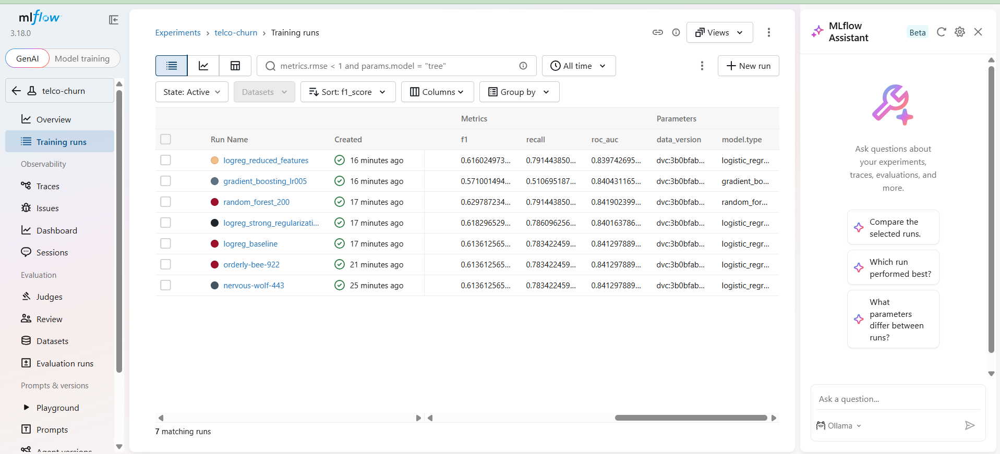

# Telco Customer Churn — End-to-End MLOps Pipeline


A production-style MLOps pipeline around a customer-churn classifier. The model is deliberately simple. The focus is the infrastructure around it:

| Concern | Tool |
|---|---|
| Code versioning | Git / GitHub |
| Data versioning | DVC (local remote) |
| Configuration | YAML (`configs/config.yaml`) |
| Experiment tracking | MLflow |
| Testing | pytest (unit, data validation, model validation) |
| CI/CD | GitHub Actions |
| Drift monitoring | Evidently |

## Dataset

**IBM Telco Customer Churn** ([source](https://github.com/IBM/telco-customer-churn-on-icp4d)): 7,043 customers of a telecom company.

- **Task:** binary classification. Predict `Churn` (Yes/No): did the customer leave in the last month?
- **Features:** 19 (4 numeric, 15 categorical), covering tenure, contract type, billing, services subscribed, and demographics.
- **Missing values:** `TotalCharges` is blank for 11 brand-new customers. These blanks are converted to NaN and median-imputed inside the sklearn pipeline.
- **Class balance:** 26.5% churn, which is why ROC-AUC (not accuracy) is the primary metric and the classifiers use balanced class weights where supported.

## Project structure

```
mlops-churn-pipeline/
├── .github/workflows/ml-pipeline.yml  # CI/CD: test job -> train job
├── configs/
│   ├── config.yaml                    # all paths, features, hyperparameters, thresholds
│   └── experiments.yaml               # 5 experiment configurations
├── data/raw/telco_churn.csv.dvc       # DVC pointer (the CSV itself is not in Git)
├── docs/                              # MLflow UI screenshot
├── src/
│   ├── data.py                        # load / download data
│   ├── preprocess.py                  # cleaning, target encoding, imputation + one-hot
│   ├── train.py                       # training + MLflow logging + threshold gate
│   ├── evaluate.py                    # metrics + threshold checks
│   ├── run_experiments.py             # runs all 5 experiments
│   ├── compare_experiments.py         # mlflow.search_runs() -> best run
│   ├── monitor_drift.py               # Evidently drift report
│   └── utils.py                       # config loading, DVC data version
├── tests/
│   ├── conftest.py                    # shared fixtures
│   ├── test_preprocess.py             # 13 unit tests
│   ├── test_data_validation.py        # 8 data validation tests
│   └── test_model.py                  # 7 model validation tests
├── MONITORING.md                      # drift analysis write-up
├── requirements.txt                   # pinned dependencies
└── pytest.ini
```

## Setup

Requires **Python 3.11–3.13** and Git. Developed on Python 3.12; CI also uses 3.12.

```bash
git clone https://github.com/Cooper-kitrel/mlops-churn-pipeline.git
cd mlops-churn-pipeline

python -m venv .venv
# Windows (PowerShell):
.venv\Scripts\Activate.ps1
# macOS/Linux:
source .venv/bin/activate

pip install -r requirements.txt
```

### Get the data

```bash
dvc pull
```

The DVC remote is a **local directory** (`../dvc-storage`, next to the repo folder), so `dvc pull` works on the machine that holds that folder. On any other machine, download the identical file from its public source:

```bash
python -m src.data --download
```

`dvc status` then reports "Data and pipelines are up to date", which confirms the downloaded file matches the tracked version's md5 hash.

> Run every script as `python -m src.<name>` from the project root.

## Training

```bash
python -m src.train --config configs/config.yaml
```

The script reads every setting from `configs/config.yaml`. Each run logs to MLflow:
- all hyperparameters and preprocessing settings
- the data version (the DVC md5 hash, e.g. `dvc:3b0bfab2...`)
- five metrics: ROC-AUC (primary), F1, precision, recall, accuracy
- the full preprocessing + model pipeline via `mlflow.sklearn.log_model()`

**It exits with code 1 if any threshold in `config.yaml → thresholds` is not met** (ROC-AUC ≥ 0.80, F1 ≥ 0.55, recall ≥ 0.50). CI uses this exit code as a quality gate.

> **Note (MLflow 3):** logged models appear under the experiment's **Models** tab (and the run's *Logged models* section) rather than the run's Artifacts tab. They can still be loaded with `mlflow.sklearn.load_model("runs:/<run_id>/model")`.

## Experiments

```bash
python -m src.run_experiments        # runs the 5 configurations in configs/experiments.yaml
python -m src.compare_experiments    # queries MLflow with search_runs(), prints the best run
mlflow ui --backend-store-uri sqlite:///mlflow.db   # http://127.0.0.1:5000 ("Model training" view)
```

| Run | What varies | ROC-AUC | F1 | Recall |
|---|---|---|---|---|
| random_forest_200 | Model type | **0.8419** | 0.6298 | 0.7914 |
| logreg_baseline | Baseline | 0.8413 | 0.6136 | 0.7834 |
| gradient_boosting_lr005 | Model type | 0.8404 | 0.5710 | 0.5107 |
| logreg_strong_regularization | Hyperparameter (C = 0.05) | 0.8402 | 0.6183 | 0.7861 |
| logreg_reduced_features | Feature set (9 of 15 categorical) | 0.8397 | 0.6160 | 0.7914 |

**Best run:** `random_forest_200` (ROC-AUC 0.8419). All five configurations land within 0.0022 ROC-AUC of each other, so model choice matters little on this dataset. Dropping six add-on service columns (`logreg_reduced_features`) cost only 0.0016 ROC-AUC against the baseline, which suggests most of the signal sits in the remaining features. Gradient boosting has much lower recall because sklearn's `GradientBoostingClassifier` has no `class_weight` option, so it under-predicts the minority (churn) class at the default 0.5 threshold.

**MLflow tracking UI** — all runs are logged to the `telco-churn` MLflow experiment:



The table shows the five configurations from `configs/experiments.yaml` (plus two single `train.py` runs), each with its logged metrics. `random_forest_200` has the highest ROC-AUC (0.8419), matching the result from `compare_experiments.py`.
## Tests

```bash
pytest tests/ -v
```

28 tests at three levels:
- **Unit tests** (`test_preprocess.py`, 13): missing-value handling, median imputation, one-hot encoding, unseen categories, target encoding, no mutation of input data, and errors raised for invalid input.
- **Data validation** (`test_data_validation.py`, 8): expected columns, target values, numeric ranges, known categories, missing-value rate, unique IDs.
- **Model validation** (`test_model.py`, 7): prediction type and shape, a minimum ROC-AUC on a fixed holdout, all configured model types train, and unknown model types raise.

## Drift monitoring

```bash
python -m src.monitor_drift                 # simulated production drift -> exits 1
python -m src.monitor_drift --no-simulate   # clean holdout (control) -> exits 0
python -m src.monitor_drift --threshold 0.5 # override the drift-share threshold
```

The reference is the training split; "production" is the held-out split with simulated post-deployment changes (a price increase, an acquisition campaign, a contract promotion, and a pipeline bug that drops 5% of `TotalCharges`). The script prints per-feature drift and the overall drift share, saves an interactive HTML report to `reports/`, and exits with code 1 when the drift share exceeds `drift.drift_share_threshold` (15%).

**Result:** 4 of 19 features drifted (21%), which triggers the alert. On the drifted data, the model's predicted churn rate rises from 41.2% to 47.8% and ROC-AUC falls from 0.841 to 0.808. See **[MONITORING.md](MONITORING.md)** for the full analysis and recommendation.

## CI/CD

`.github/workflows/ml-pipeline.yml` runs on every push to `main` and on every pull request targeting `main`:

1. **test**: installs dependencies, fetches the dataset, runs `pytest tests/ -v`
2. **train** (`needs: test`): trains the model and fails if a performance threshold is missed, then uploads the model and metrics as build artifacts

CI downloads the dataset from its public source because GitHub's runners cannot reach the local DVC remote.